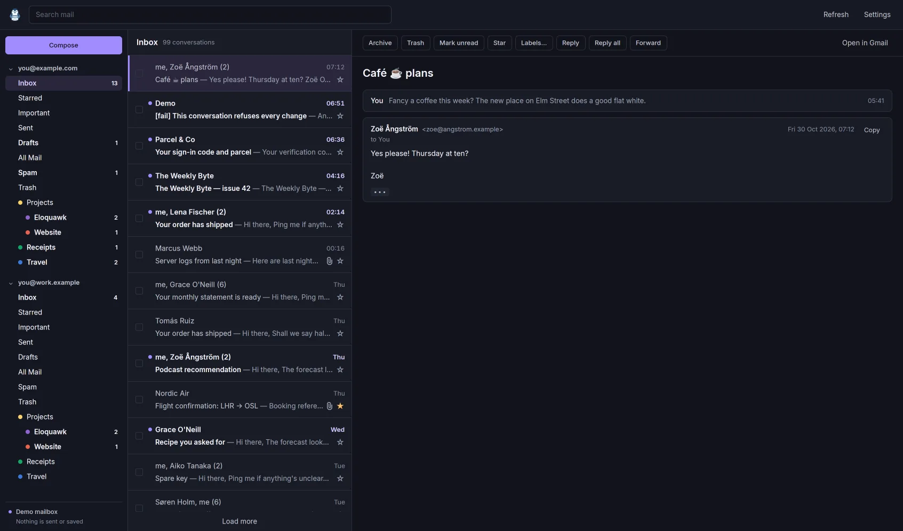

# Eloquawk

A native Gmail client for Linux, built with Rust and [GPUI](https://www.gpui.rs/). Read, triage and answer mail from several Google accounts in one fast, keyboard-driven window, with Gmail's own shortcuts and desktop notifications for new mail.

[Google setup](docs/google-gmail.md) · [Desktop integration](docs/desktop-integration.md) · [Report a bug](https://github.com/korora-tech/eloquawk/issues) · [Apache 2.0](LICENSE)

> [!IMPORTANT]
> **Gmail integration is currently limited to approved testers.** Eloquawk asks for Gmail's restricted `gmail.modify` scope, and its Google project is in Testing, so Google only lets listed accounts sign in. To use the built-in client, email [david@rawkode.academy](mailto:david@rawkode.academy?subject=Eloquawk%20tester%20access) with the Google account address you want to connect and ask to be added, or [bring your own OAuth client](docs/google-gmail.md#using-your-own-oauth-client). **Demo mode is available to everyone**, without Google sign-in.



*A real app capture using the generated demo mailbox. More: [an HTML newsletter in the light theme](docs/screenshots/demo-newsletter-light.webp), [a reply](docs/screenshots/demo-reply.webp), [search](docs/screenshots/demo-search.webp) and [the shortcut overlay](docs/screenshots/demo-shortcuts.webp).*

## What it does

- **Several Google accounts:** each account's labels sit in the sidebar with their unread counts; collapse the ones you are not using.
- **Gmail's keyboard shortcuts:** `j`/`k`, `e` to archive, `#` to trash, `r` to reply, `g i` for the inbox and the rest, with `?` showing them all. Archive, trash, spam, star and label changes apply at once and can be undone with `z`.
- **Conversations as plain text:** HTML mail is converted to text, links show where they really go, remote images are never loaded, and you can select and copy any part of a message.
- **Compose, reply, reply all and forward:** in their own windows, with attachments up to 25 MB and the original attachments carried along when forwarding.
- **Search and labels:** Gmail's own search syntax, sent to Gmail as you typed it, and a label picker (`l`) for your own labels.
- **Attachments:** save them to your download directory with one click.
- **New-mail notifications:** for unread mail that lands in the inbox, skipping Gmail's Promotions, Social, Updates and Forums categories.
- **Mail handler:** registers for `mailto:` links and hands them to the running window.
- **Message checks (optional, off by default):** with your own OpenRouter key, Jev flags likely phishing, scams and spam in the accounts you turn on. See [Message checks](#message-checks).
- **Local credential storage:** refresh tokens stay in your system keyring; mail stays in memory and is never written to disk. No analytics or telemetry.

**Current limits:** Eloquawk does not render HTML mail, edit or sync drafts (Drafts are listed read-only), use send-as aliases or signatures, snooze, schedule sends, manage filters or labels, or delete permanently. There is no offline cache, so mail is fetched again at startup, and no tray icon: closing the last window quits.

## Message checks

Eloquawk can ask Jev, TypeSafe's decision model, through [OpenRouter](https://openrouter.ai)
whether a message looks like phishing, a scam or spam. It is off until you save an OpenRouter
key in Settings and turn it on for an account, after a disclosure of exactly what is sent. A
redacted extract of the one message you open goes to OpenRouter: links are cut to their
website name, your and the recipients' addresses and recognised one-time codes are replaced,
and attachments, the recipient list and the rest of the thread are never sent. Requests ask
for zero data retention; your OpenRouter account's own logging and Broadcast settings still
apply, so use a dedicated key with those off. Each check costs a fraction of a cent, and a
per-session spend limit (default $1.00) stops them.

Results are advisory: a banner and a list badge, never an automatic move. Independently of
Jev and for every account, a message that fails DMARC and has a link whose text names another
site shows "Eloquawk noticed: …", and its web links ask before opening. That guard is best
effort. Details, costs and limits: [docs/ai-triage.md](docs/ai-triage.md). Demo mode uses an
offline checker and sends nothing.

## Try it without a Google account

On a Linux desktop with [Nix](https://nixos.org/download/) and flakes enabled:

```sh
nix run github:korora-tech/eloquawk -- --demo
```

Demo mode generates two accounts with about 160 conversations between them. It does not connect to Google, touch your keyring, send mail, save files or save preferences, and it runs alongside your signed-in instance. About 20 seconds after it starts, a new message arrives so you can see a notification.

## Install and run

Nix packages are provided for `x86_64-linux` and `aarch64-linux`.

```sh
# Launch without adding it to your profile
nix run github:korora-tech/eloquawk

# Install, then launch from your terminal or desktop application menu
nix profile add github:korora-tech/eloquawk
eloquawk
```

On older Nix versions, use `nix profile install` in place of `nix profile add`. If Nix asks you to enable experimental features, add `experimental-features = nix-command flakes` to `~/.config/nix/nix.conf`. Home Manager users can use the [module](docs/desktop-integration.md#home-manager) instead.

Your desktop needs:

- A Wayland or X11 session and working Vulkan support for GPUI rendering.
- An unlocked [Secret Service](https://specifications.freedesktop.org/secret-service-spec/latest/) keyring for Google sign-in, such as GNOME Keyring, KWallet or KeePassXC with its Secret Service integration enabled.
- A notification daemon, if you want new-mail notifications.
- An XDG desktop portal with a file chooser, to attach files to a message.

### Connect your Gmail

1. [Request tester access](mailto:david@rawkode.academy?subject=Eloquawk%20tester%20access) and wait for confirmation for the Google account you intend to use.
2. Open Eloquawk and choose **Sign in with Google**. Approve access on Google's consent page in your browser, then return to the app.
3. To connect another approved account, open **Settings** (`Ctrl+,`) and choose **Add account**.

You can also use a Google OAuth client of your own. The [Gmail guide](docs/google-gmail.md) covers creating one, testing-mode sign-in expiry, where credentials live, how sync works and which mail notifies.

To make Eloquawk your mail handler, see [desktop integration](docs/desktop-integration.md#mailto-links).

## Keyboard shortcuts

These are the keys the `?` overlay shows. Mail keys do nothing while a text field has focus.

| Keys | Action | Where |
| --- | --- | --- |
| `j` or `↓` | Next conversation | Mail |
| `k` or `↑` | Previous conversation | Mail |
| `n` | Next message | Mail |
| `p` | Previous message | Mail |
| `o` or `Enter` | Open, or toggle message | Mail |
| `u` or `Esc` | Back to the list | Mail |
| `Space` or `Page Down` | Scroll down a page | Mail |
| `Shift Space` or `Page Up` | Scroll up a page | Mail |
| `x` | Select conversation | Mail |
| `e` | Archive, or Not spam | Mail |
| `#` | Trash, or Restore | Mail |
| `s` | Star or unstar | Mail |
| `Shift I` | Mark as read | Mail |
| `Shift U` | Mark as unread | Mail |
| `!` | Report spam | Mail |
| `l` | Labels | Mail |
| `r` | Reply | Mail |
| `a` | Reply all | Mail |
| `f` | Forward | Mail |
| `c` | Compose | Mail |
| `z` | Undo | Mail |
| `;` | Expand all messages | Mail |
| `:` | Collapse all messages | Mail |
| `/` | Search | Mail |
| `g then i` | Go to Inbox | Mail |
| `g then s` | Go to Starred | Mail |
| `g then t` | Go to Sent | Mail |
| `g then d` | Go to Drafts | Mail |
| `g then a` | Go to All Mail | Mail |
| `g then n` | Next account | Mail |
| `g then p` | Previous account | Mail |
| `?` | Keyboard shortcuts | Mail |
| `Ctrl c` | Copy the selection | Message text |
| `Ctrl a` | Select the whole message | Message text |
| `Esc` | Close the picker | Label picker |
| `↑` | Previous label | Label picker |
| `↓` | Next label | Label picker |
| `Enter` | Search this account | Search |
| `Esc` | Clear and leave search | Search |
| `Ctrl Enter` | Send | Compose window |
| `Esc` or `Ctrl w` | Close the message | Compose window |
| `Ctrl q` | Quit | Compose window |
| `Esc` | Close Settings | Settings |
| `Ctrl r` | Refresh | Anywhere |
| `Ctrl ,` | Settings | Anywhere |
| `Ctrl n` | Compose | Anywhere |
| `Ctrl w` | Close the window | Anywhere |
| `Ctrl q` | Quit | Anywhere |

## Troubleshooting

| Problem | What to check |
| --- | --- |
| Google blocks sign-in or says the app is unverified | The exact Google account must be on the tester list for the built-in client. [Request access by email](mailto:david@rawkode.academy?subject=Eloquawk%20tester%20access), or [use your own client](docs/google-gmail.md#using-your-own-oauth-client). |
| "Google signed you@… out" | Testing-mode Gmail authorisations expire after seven days. Add the account again in Settings. [Details](docs/google-gmail.md#testing-mode-and-the-seven-day-sign-in). |
| Keyring is locked or unavailable | Start or unlock your Secret Service provider, then select **Retry** or press `Ctrl+R`. |
| "Couldn't reach Google" | Eloquawk keeps what it has on screen and retries on its own; `Ctrl+R` tries again now. |
| "Couldn't confirm the message was sent" | The connection dropped while sending. Look in Sent before sending again; the compose window waits for you to tick **Send anyway**. |
| No notifications | Check **Notify about new mail** in Settings and that a notification daemon is running. Mail filed under Promotions, Social, Updates or Forums never notifies, and nothing notifies during an account's first sync. |
| **Attach…** does nothing or shows "Couldn't open the file chooser" | Install and start an XDG desktop portal with a file chooser backend (for example `xdg-desktop-portal-gtk` or `-gnome`). |
| Unread mail looks the same as read mail | Your system has none of the fonts Eloquawk looks for, so weights render regular. The Nix package bundles Inter; elsewhere install Inter, Noto Sans or Cantarell. |
| A second launch does nothing | Eloquawk is already running and was asked to show its window. Without `$XDG_RUNTIME_DIR` there is no single instance. |

## Development

```sh
git clone https://github.com/korora-tech/eloquawk.git
cd eloquawk
nix develop -c cargo run -- --demo
```

The Nix development shell supplies Rust and the native build dependencies. Run the app normally with `nix develop -c cargo run --release`, or build the packaged application with `nix build`. Debug builds honour `ELOQUAWK_SECRETS=memory`, which keeps credentials in memory instead of your keyring.

```sh
nix develop -c cargo fmt --check
nix develop -c cargo clippy --all-targets -- -D warnings
nix develop -c cargo test
nix flake check
```

`--demo-actions` scripts the demo for checks and screenshots: `scripts/screenshot.sh <name> [steps] [theme]` captures a window on [niri](https://github.com/YaLTeR/niri). The step grammar and the full design live in [docs/SPEC.md](docs/SPEC.md).

| Location | Purpose |
| --- | --- |
| `src/ui/` | GPUI views: the three panes, reader, composer, label picker, Settings and the shortcut overlay |
| `src/google/`, `src/sync.rs`, `src/secrets.rs` | Gmail API, OAuth, the sync worker and keyring storage |
| `src/mail/` | Parsing Gmail payloads, HTML to text, links, addresses, replies, outgoing MIME and `mailto:` |
| `src/store.rs`, `src/protocol.rs` | The UI's state with optimistic changes and undo, and its messages to and from the worker |
| `src/demo.rs`, `src/demo_data.rs`, `src/demo_script.rs` | The generated demo mailbox and its scripting |
| `src/notify.rs`, `src/instance.rs` | New-mail notifications and the single instance |
| `data/`, `nix/hm-module.nix` | Desktop entry, icon and Home Manager module |
| `docs/` | Guides, the specification and demo screenshots |

Bug reports should include your desktop environment, Wayland or X11, how you installed the app, and steps to reproduce. Demo mode is useful for sharing a screenshot without exposing your mail.

## Licence

Eloquawk's code, documentation and original artwork are licensed under the [Apache License, Version 2.0](LICENSE). Third-party dependencies retain their own licences.
